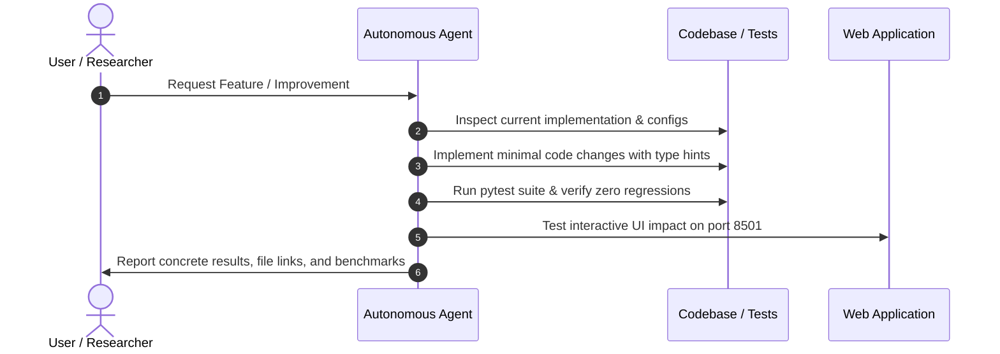

# AGENTS.md — Autonomous Agent Guidelines & System Architecture

## 1. Overview & Operational Mandate
This document specifies the operational rules, tools, execution constraints, and behavioral contracts for AI coding assistants, autonomous developer subagents, and human pair-programmers operating on the **SeedVision AI** codebase.

SeedVision AI is a production-grade, college-level Deep Learning Applications (DLA) computer vision system for agricultural pulse quality grading with Grad-CAM explainability. It is **not** an LLM wrapper or prototype: real weights, actual training history, leakage-free data splits, and verifiable unit tests are strictly mandated.

---

## 2. Universal Engineering & Coding Disciplines

### 2.1 Code Quality & The Senior Dev Ladder
1. **YAGNI (You Aren't Gonna Need It)**: Do not add speculative abstractions, mock frameworks, or unused microservices.
2. **Code Reuse Hierarchy**: Internal utility modules $\rightarrow$ Python standard library $\rightarrow$ PyTorch/Torchvision native APIs $\rightarrow$ External pinned dependencies.
3. **Minimal Working Diffs**: Make targeted, surgical edits that solve root causes without churning unrelated lines.
4. **Explicit State & Shadow Paths**: Always account for:
   - Happy path: Valid seed image $\rightarrow$ prediction $\rightarrow$ Grad-CAM overlay.
   - Corrupted image / zero-byte upload $\rightarrow$ graceful `InferenceInputValidator` rejection.
   - Low confidence / out-of-distribution input $\rightarrow$ `is_uncertain=True` flag with actionable reason.
   - Missing or un-downloadable weights $\rightarrow$ offline fallback or descriptive setup instructions.

### 2.2 Scientific Rigor & Ethics
- **Zero Fabrication**: Never fabricate accuracy numbers, confusion matrices, latency benchmarks, or user review metrics.
- **Surface Observation Boundary**: Never claim optical classification verifies seed germination rate, internal embryo viability, or official regulatory seed lot certification.
- **Hook Hygiene**: Grad-CAM forward and backward hooks must be cleanly removed (`gradcam.remove_hooks()`) upon completion to prevent CPU/GPU memory leaks.

---

## 3. Repository Architecture & Component Map

| Path | Architectural Responsibility | Primary Contracts / Interfaces |
| :--- | :--- | :--- |
| `src/seedvision/config.py` | Configuration hierarchy & YAML loading | `SeedVisionConfig`, `load_config()` |
| `src/seedvision/data/` | Ingestion, validation, splitting, datasets | `ImageValidator`, `SeedDataset`, `create_leakage_resistant_splits` |
| `src/seedvision/models/` | Neural network architectures & factory | `CustomSeedCNN`, `SeedTransferModel`, `build_model` |
| `src/seedvision/training/` | Training loop, checkpointing, history | `SeedTrainer`, `CheckpointManager`, `TrainingHistory` |
| `src/seedvision/evaluation/` | Metrics, plots, cross-model comparison, provenance verification | `ModelEvaluator`, `verify_evaluation_provenance`, `compute_ece`, `compare_models` |
| `src/seedvision/explainability/` | Grad-CAM attribution engine | `GradCAM`, `generate_gradcam_overlay` |
| `src/seedvision/inference/` | Inference predictor & input validation | `SeedPredictor`, `InferenceInputValidator` |
| `scripts/` | Executable CLI tools | `prepare_dataset.py`, `train.py`, `evaluate.py`, `predict.py` |
| `app.py` | Streamlit interactive web laboratory | Multi-page dashboard on port 8501 |
| `tests/` | Automated unit & regression suite | 99 pytest cases covering all components |

---

## 4. Agent Tooling & Execution Rules

### 4.1 Shell & Environment (Windows PowerShell)
- Always run commands from the workspace root (`d:\AI\Projects\SeedVision AI`).
- Use `python -m pip` or `python` targeting the user's verified Python environment (`Python 3.13`, e.g. `C:\Users\<user>\AppData\Local\Programs\Python\Python313\python.exe`).
- When running long commands (e.g. training), use `WaitMsBeforeAsync: 5000` and monitor task status via reactive wakeup.
- CPU compatibility is the primary default; GPU is detected automatically via `torch.cuda.is_available()`.

### 4.2 Automated Test Enforcement
Whenever modifying any core component in `src/seedvision/`:
1. Run `pytest tests/ -v` to ensure all 99 tests remain passing.
2. If new functionality is introduced (e.g., test-time augmentation, new pulse varieties), add corresponding unit tests under `tests/`.

---

## 5. Agent Workflow for Feature Delivery

---

## 6. Definition of Done (DoD)
A task or pull request is complete only when:
- [x] Code is clean, maintainable, and adheres to PEP 8 standards.
- [x] All 99 tests pass without errors or warnings.
- [x] Relevant documentation (`README.md`, `docs/`, `CHANGELOG.md`) is updated.
- [x] No sensitive tokens, hardcoded developer paths, or giant checkpoint blobs are committed to Git.
- [x] Limitations regarding biological seed viability are clearly retained.
