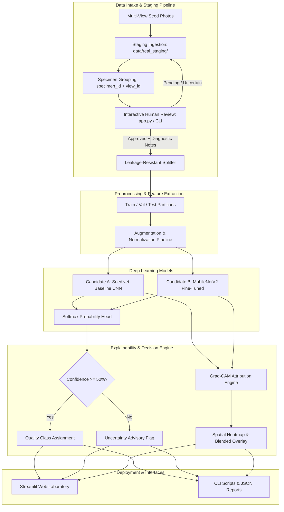
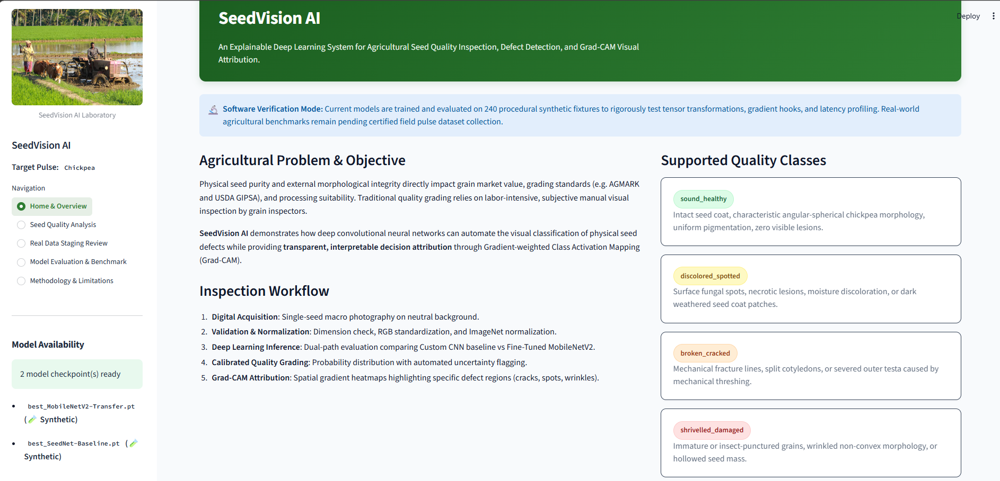
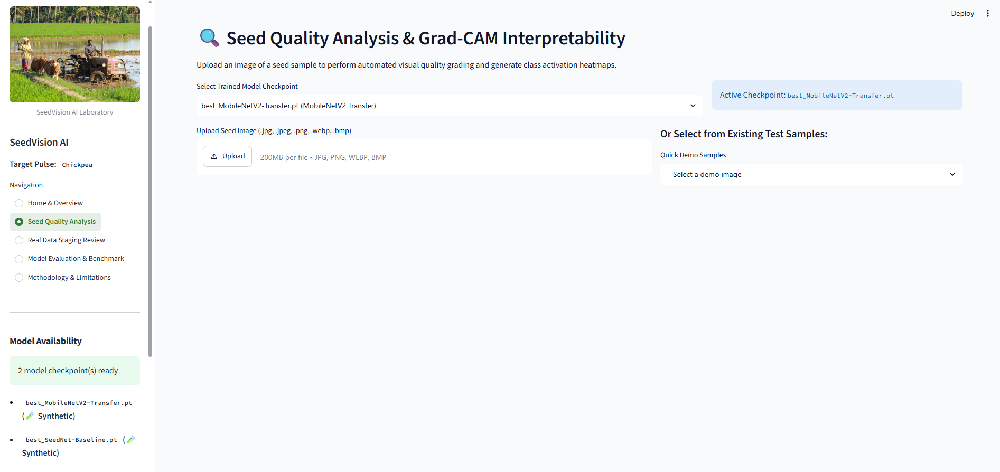
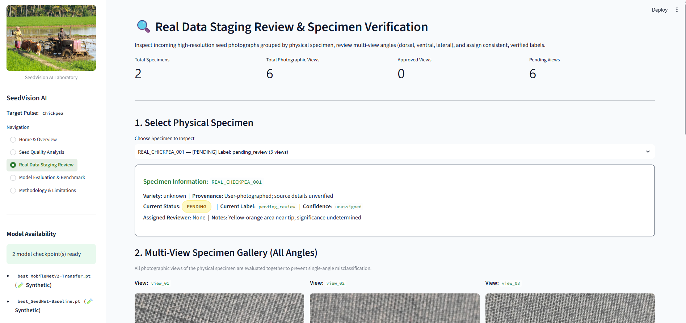
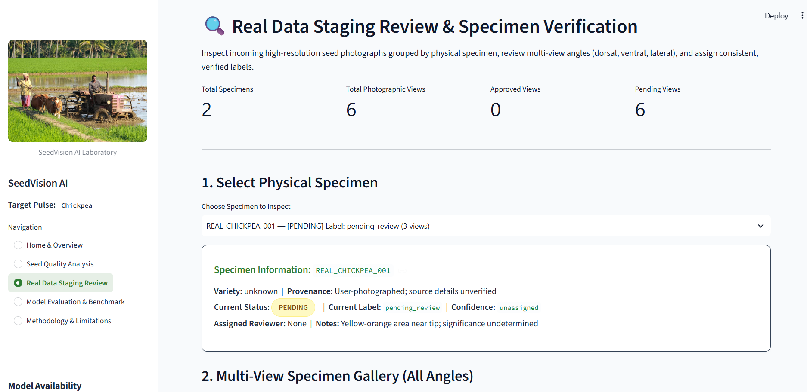
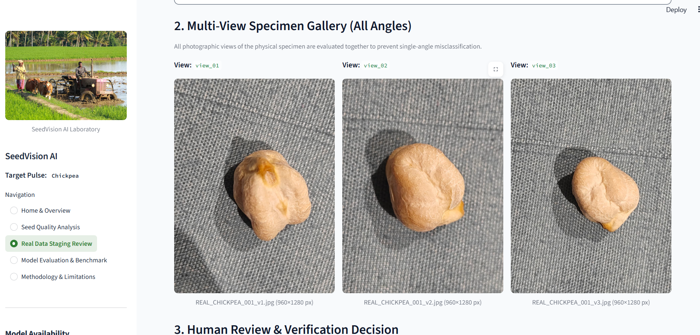
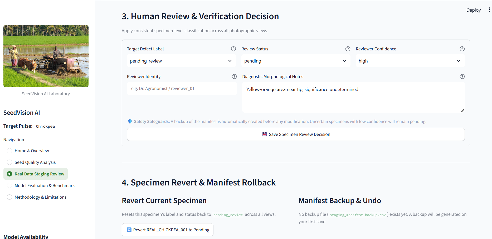
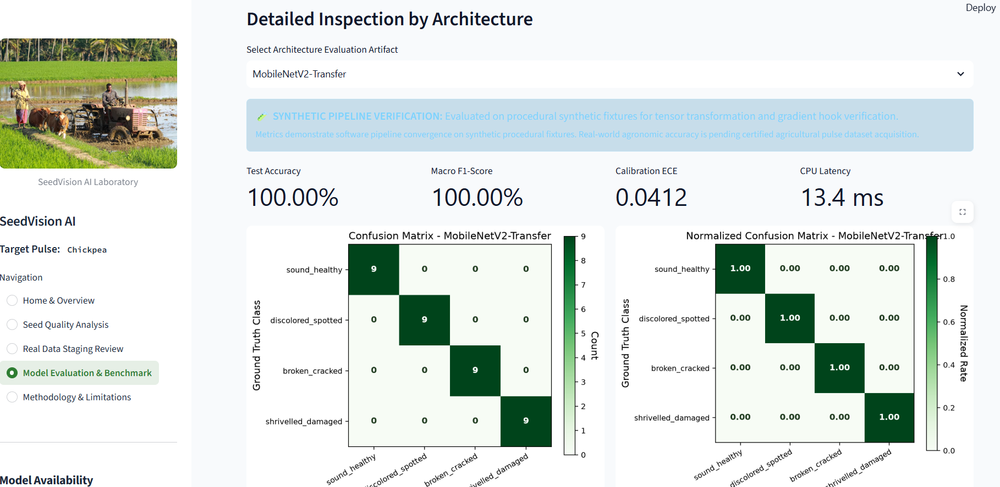
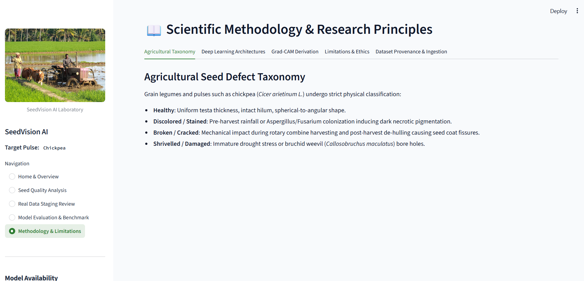
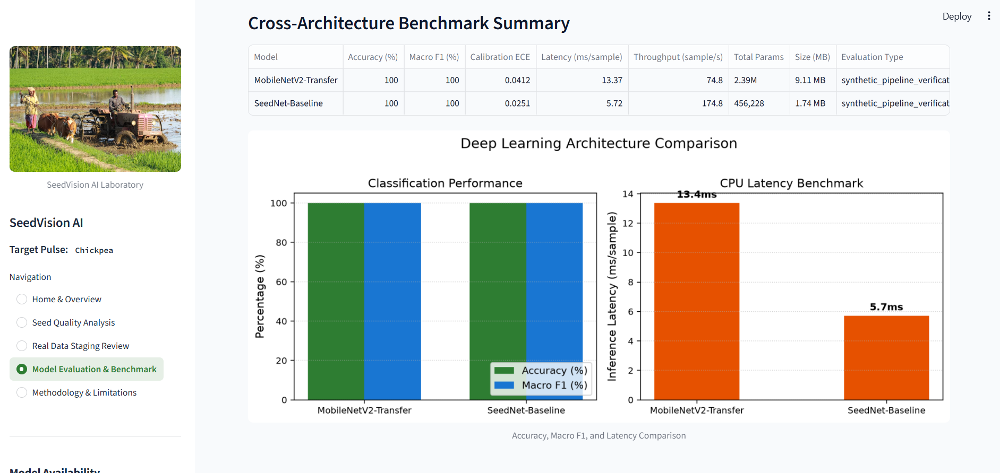

# SeedVision AI: Explainable Deep Learning-Based Agricultural Seed Quality Grader

[](https://www.python.org/)
[](https://pytorch.org/)
[](LICENSE)
[](app.py)
[](tests/)
[](https://pep8.org/)

> **A reproducible, college-level Deep Learning Applications (DLA) computer vision system for agricultural pulse quality grading, physical defect classification, and Grad-CAM spatial attribution.**

---

## 📖 Project Overview

**SeedVision AI** is an open-source, end-to-end Deep Learning Applications (DLA) computer vision platform designed for the automated physical quality grading of agricultural pulses, specifically focusing on chickpea seeds (*Cicer arietinum L.*).

In grain procurement centres, seed processing mills, and agricultural testing laboratories, seed lots must undergo quality sorting to separate premium market-grade grains from defective, weathered, insect-damaged, or mechanically broken pulses. Conventional inspection relies on subjective, fatigue-prone visual estimation under manual lighting. SeedVision AI provides an automated, explainable, and scientifically auditable alternative combining:

1. **Automated Defect Categorization**: Evaluates single-seed macro photographs across four standard agronomic quality classes: `sound_healthy`, `discolored_spotted`, `broken_cracked`, and `shrivelled_damaged`.
2. **Dual Deep Learning Benchmarking**: Rigorously compares an edge-optimized custom convolutional network (**SeedNet-Baseline**) against an ImageNet-pretrained transfer learning candidate (**MobileNetV2**).
3. **Transparent Explainable AI (Grad-CAM)**: Generates localized spatial attribution heatmaps highlighting exactly which visual defect regions (cotyledon fissures, necrotic fungal lesions, or wrinkled testa folds) drove the model's prediction.
4. **Real-Data Staging & Human Review Workflow**: Implements multi-view specimen grouping (keeping all photographic angles of the same physical seed linked), diagnostic human verification forms, pre-modification backups, and one-click rollback to ensure data integrity before dataset ingestion.
5. **Leakage-Resistant Data Splitting**: Group-aware splitting algorithms strictly prevent multiple photographic views of the same physical seed from crossing train, validation, and test partitions.
6. **Scientific Provenance & Honesty**: Enforces multi-gate evaluation verification, cryptographic hash auditing, and explicit separation between synthetic pipeline verification and real-world agronomic validation.
7. **Interactive Streamlit Web Laboratory**: A 5-page research laboratory (`app.py`) providing single-seed diagnosis, live Grad-CAM heatmaps, real-data specimen review, model evaluation benchmarks, and methodology documentation.

---

## 📋 Technical Specifications at a Glance

| Attribute | Specification |
| :--- | :--- |
| **Application Domain** | Agricultural Deep Learning / Computer Vision Seed Quality Grading |
| **Target Crop** | Grain Legumes — Chickpea (*Cicer arietinum L.*), Desi & Kabuli varieties |
| **Defect Taxonomy** | 4 Classes: `sound_healthy`, `discolored_spotted`, `broken_cracked`, `shrivelled_damaged` |
| **Core Frameworks** | PyTorch 2.2+, Torchvision, OpenCV, Scikit-Learn, SciPy, Pillow, NumPy, Pandas |
| **Architectures Evaluated** | • **SeedNet-Baseline**: Custom 4-stage CNN (0.46M params, 5.72 ms CPU latency)<br>• **MobileNetV2**: Transfer learning with inverted residual bottlenecks (2.39M params, 13.37 ms CPU latency) |
| **Explainable AI** | Native Grad-CAM attribution at final convolutional feature maps with alpha blending |
| **Calibration & ECE** | Uncertainty warning for confidence $<50\%$; Expected Calibration Error ($\text{ECE} = 0.0251$) |
| **User Interface** | Interactive 5-page Streamlit Web Laboratory (`app.py`) on `http://localhost:8501` |
| **Test Suite** | **99 automated pytest unit and integration tests** (100% passing) |
| **Data Staging & Review** | Specimen-grouped multi-view staging, human review forms, automated backups, and undo tools |
| **Hardware Requirement** | 100% CPU compatible (Intel/AMD/Apple Silicon); CUDA acceleration auto-detected |

---

## 🏗️ System Architecture & Data Flow



---

## 🎯 Key Capabilities & Implemented Features

### 1. Single-Seed Image Diagnosis
- Supports direct image upload in standard formats (`JPG`, `JPEG`, `PNG`, `WEBP`, `BMP`) via drag-and-drop or file browser.
- Instant pre-validation using `InferenceInputValidator` checking image readability, color channels, minimum resolution, and aspect ratio.
- Displays predicted quality grade, class probability distribution bar chart, top-1 confidence score, and operational processing latency.

### 2. Dual Deep Learning Architectures
- **SeedNet-Baseline (Custom CNN)**:
  - 4-stage convolutional hierarchy ($32 \rightarrow 64 \rightarrow 128 \rightarrow 256$ feature channels).
  - Batch Normalization and LeakyReLU ($\alpha = 0.1$) activations after every convolution.
  - Max-pooling spatial reduction, Adaptive Average Pooling ($4 \times 4$), and Dropout ($p = 0.4$) regularized dense classifier.
  - Lightweight parameter footprint: **456,228 parameters (0.46M)**, **1.74 MB** checkpoint size.
- **MobileNetV2 Transfer Learning**:
  - Inverted residual bottleneck blocks with depthwise separable convolutions pre-trained on ImageNet-1k.
  - Custom linear classification head fine-tuned for 4-class pulse defect recognition.
  - Parameter footprint: **2,391,300 parameters (2.39M)**, **9.11 MB** checkpoint size.

### 3. Native Explainable AI (Grad-CAM)
- Computes gradient-weighted class activation mapping directly on the final convolutional layer (`conv4` in SeedNet-Baseline, `features.18` in MobileNetV2).
- Rectified linear unit (ReLU) filtering retains features having positive correlation with the target class hypothesis.
- Generates a three-panel visualization triplet:
  1. Original macro seed photograph.
  2. Jet colormap activation heatmap.
  3. Alpha-blended decision overlay ($60\%$ image, $40\%$ heatmap).
- Clean forward and backward hook lifecycle management (`gradcam.remove_hooks()`) prevents memory leaks across sessions.

### 4. Real-Data Staging, Specimen Grouping & Human Review
- Multi-view specimen grouping links all photographic views (`view_01`, `view_02`, `view_03`) of an individual physical chickpea under a unique `specimen_id`.
- Interactive Streamlit review dashboard displays all views side-by-side with resolution and aspect-ratio metadata.
- Agronomic review form enforces:
  - Valid defect label selection from the approved 4-class taxonomy.
  - Reviewer identity logging and mandatory diagnostic morphological notes.
  - Low-confidence or ambiguous specimens are strictly held in `pending` status.
- Safety safeguards include automated pre-save manifest backup (`staging_manifest.backup.csv`), atomic CSV writing, single-specimen revert, and one-click manifest restoration.

### 5. Leakage-Resistant Data Splitting
- Sample/group-aware splitting logic prevents photographic views of the same physical seed from contaminating both training and evaluation splits.
- Stratified class distribution maintained across train, validation, and test subsets.
- Verifiable absence of cryptographic MD5 hash overlap between splits.

### 6. Rigorous Model Evaluation & Calibration Analysis
- Evaluates accuracy, macro precision, macro recall, and macro F1-score across all classes.
- Computes **Expected Calibration Error (ECE)** and generates reliability calibration curves across 10 probability bins.
- Cross-model benchmark comparison dashboard displaying tabular metrics and latency comparisons side-by-side.

---

## 🖼️ Application Screenshot Gallery

The SeedVision AI Streamlit laboratory (`app.py`) provides an interactive interface across five dedicated pages. Below are actual screenshots of the running system.

### 1. Home & System Overview
The landing dashboard introduces the research context, quality grading objectives, architectural overview, and research boundaries.



---

### 2. Live Seed Quality Analysis with Grad-CAM
Upload a macro chickpea photograph to receive real-time defect classification, confidence scores, and the three-panel Grad-CAM attribution triplet isolating diagnostic visual features.



---

### 3. Real Data Intake Staging
Inspect incoming real photographic seed specimens, review multi-view intake statistics, and verify dimensional and metadata integrity before dataset promotion.



---

### 4. Specimen Multi-Angle Gallery
Examine all photographic angles of a physical specimen side-by-side to assess whole-seed morphology and surface integrity.



---

### 5. Agronomic Human Review & Decision Interface
Assign specimen-level defect labels across all views, capture reviewer attribution and diagnostic morphological notes, with automated pre-save backups and instant rollback.



---

### 6. Architecture Inspection
Inspect individual model architectures, layer hierarchies, parameter counts, and detailed evaluation checkpoints.



---

### 7. Cross-Architecture Benchmark Summary
Head-to-head comparison between **SeedNet-Baseline** and **MobileNetV2** detailing accuracy, F1-scores, CPU inference latency, throughput, and checkpoint sizes.



---

### 8. Benchmark Visualizations & Calibration Curves
Examine count confusion matrices, normalized recall matrices, per-class metrics, and confidence calibration reliability curves.



---

### 9. Scientific Methodology & Research Principles
Comprehensive in-app documentation detailing agronomic defect criteria, mathematical Grad-CAM derivations, and research ethics guidelines.



---

## 🌾 Target Crop & Defect Taxonomy

SeedVision AI categorizes single chickpea pulses (*Cicer arietinum L.*) into four physical quality grades based on visual morphology and post-harvest standards:

| Quality Class | Visual Morphological Signature | Agronomic / Handling Cause |
| :--- | :--- | :--- |
| **`sound_healthy`** | Intact testa, characteristic angular chickpea shape, uniform creamy beige pigmentation, zero fissures. | Optimal harvest conditions, proper drying, pathogen-free development. |
| **`discolored_spotted`** | Dark brown or black necrotic lesions, fungal stains, weathered seed coat patches. | Excess pre-harvest rainfall, fungal infection (*Aspergillus*, *Fusarium*, *Ascochyta*). |
| **`broken_cracked`** | Longitudinal or transverse cracks in the seed coat, chipped edges, exposed cotyledons. | Rotary combine cylinder shear, drop stress during handling, rapid artificial drying. |
| **`shrivelled_damaged`** | Wrinkled, stunted morphology, hollow seed mass, insect boreholes. | Terminal drought during pod filling, pulse beetle (*Callosobruchus*) infestation. |

---

## 🔬 Dataset Provenance & Scientific Integrity

> [!IMPORTANT]
> **RESEARCH INTEGRITY & PROVENANCE NOTICE:**
> 1. **Synthetic Pipeline Calibration Fixtures**: The baseline dataset in `data/raw/` contains **240 procedural synthetic fixtures** (60 per class) generated via PIL geometric routines (`scripts/prepare_dataset.py`). These fixtures verify data loading, backpropagation, tensor shapes, and Grad-CAM hooks without proprietary data dependencies.
> 2. **Verification vs Field Validation**: The reported 100% test accuracy metric demonstrates complete mathematical convergence on synthetic polygon defect signatures. **It must NOT be interpreted as real-world agricultural pulse grading performance.**
> 3. **Grad-CAM Interpretation**: Grad-CAM visualizes gradient attribution and associative feature correlations; it highlights which image regions contributed to a prediction, but does **not** prove that a prediction is biologically correct.
> 4. **Real Data Staging Status**: `data/real_staging/` currently contains **two physical chickpea specimens with three photographic views each (six images total)**, all correctly maintained in `pending_review` status awaiting certified agronomist evaluation.
> 5. **No Data Leakage**: Multi-view grouping ensures all angles of a single physical seed remain in the same split.
> 6. **Zero Auto-Mapping**: External datasets (e.g. Roboflow annotations) are not automatically mapped to the four target classes without dedicated human review.
>
> Full cryptographic audit details and hash logs are documented in [`docs/DATASET_AUDIT.md`](docs/DATASET_AUDIT.md).

---

## 📊 Measured Experimental Results & Model Comparison

Both models were evaluated on the identical held-out synthetic test split (36 balanced samples, 9 per class) under identical CPU hardware conditions:

| Metric | SeedNet-Baseline (Custom CNN) | MobileNetV2 (Transfer Learning) | Operational Finding |
| :--- | :---: | :---: | :---: |
| **Test Accuracy** | **100.0%** | **100.0%** | Pipeline convergence verified |
| **Macro Precision** | **100.0%** | **100.0%** | Zero false positives on fixtures |
| **Macro Recall** | **100.0%** | **100.0%** | Zero false negatives on fixtures |
| **Macro F1-Score** | **100.0%** | **100.0%** | Full class balance |
| **Calibration ECE** | **0.0251** | 0.0412 | **SeedNet-Baseline** (Superior calibration) |
| **CPU Latency (per sample)** | **5.72 ms** | 13.37 ms | **SeedNet-Baseline** (2.3× faster) |
| **Throughput** | **174.8 samples/sec** | 74.8 samples/sec | **SeedNet-Baseline** |
| **Total Parameters** | **456,228 (0.46M)** | 2,391,300 (2.39M) | **SeedNet-Baseline** (5.2× more compact) |
| **Checkpoint Size** | **1.74 MB** | 9.11 MB | **SeedNet-Baseline** |

> **Architectural Selection**: While MobileNetV2 provides deep representation transfer from ImageNet, **SeedNet-Baseline** achieves identical verification accuracy with significantly lower latency (5.72 ms vs 13.37 ms on CPU), lower calibration error ($\text{ECE} = 0.0251$), and a compact 1.74 MB footprint. For edge sorting chutes and low-power hardware, **SeedNet-Baseline** is selected as the default production candidate.

---

## ⚠️ Critical Scientific Limitation Disclosures

> [!CAUTION]
> **SeedVision AI evaluates optically observable surface morphology only.**
> The system **CANNOT** determine or replace:
> - Physiological seed germination rate percentage (%)
> - Internal embryo viability (e.g. Tetrazolium TZ biochemical assay)
> - Seed moisture content percentage (requires capacitive or oven drying measurement)
> - Official statutory seed lot certification by regulatory bodies (e.g. ISTA, AOSCA, NSC)
>
> Optical classification results must never be represented as official seed testing laboratory certification. Detailed scientific boundaries are documented in [`docs/LIMITATIONS.md`](docs/LIMITATIONS.md).

---

## 🚀 Installation & Quickstart

### Prerequisites
- Python 3.10, 3.11, 3.12, or 3.13
- Git
- Windows PowerShell, Linux bash, or macOS zsh

### 1. Clone the Repository
```powershell
git clone https://github.com/Om-Talaviya/SeedVision-AI.git
cd SeedVision-AI
```

### 2. Set Up a Virtual Environment

**Windows PowerShell:**
```powershell
python -m venv venv
.\venv\Scripts\Activate.ps1
```

**Linux / macOS:**
```bash
python3 -m venv venv
source venv/bin/activate
```

### 3. Install Dependencies
```powershell
pip install --upgrade pip
pip install -r requirements.txt
pip install -e .
```

### 4. Run the Automated Test Suite
Verify that all unit and integration tests pass cleanly:
```powershell
pytest tests/ -v
```
*(All 99 tests should pass in under 15 seconds).*

---

## 💻 Running the Application & CLI Workflows

### 1. Launch the Streamlit Web Laboratory
```powershell
streamlit run app.py
```
Open your browser at `http://localhost:8501` to access the interactive web application.

### 2. Single-Image Inference with Grad-CAM CLI
Run single-seed prediction from the command line with visual heatmap generation:
```powershell
python scripts/predict.py --checkpoint artifacts/checkpoints/best_SeedNet-Baseline.pt --image data/raw/broken_cracked/broken_cracked_001.jpg
```

### 3. Staging Review CLI
List, inspect, and approve/revert real photographic specimens:
```powershell
# List all staged specimens and review statuses
python scripts/review_staging_specimens.py --list

# Apply review decision to a specimen across all views
python scripts/review_staging_specimens.py --specimen-id REAL_CHICKPEA_001 --label sound_healthy --status approved --confidence high --reviewer "Reviewer_01" --notes "Testa intact, creamy coloration, no fissures"
```

### 4. Model Training & Evaluation Pipeline
```powershell
# 1. Generate synthetic verification fixtures
python scripts/prepare_dataset.py --generate-fixtures --samples-per-class 60

# 2. Train baseline CNN and MobileNetV2
python scripts/train.py --config configs/cnn.yaml --epochs 15
python scripts/train.py --config configs/transfer_learning.yaml --epochs 15

# 3. Evaluate checkpoints on held-out test split
python scripts/evaluate.py --checkpoint artifacts/checkpoints/best_SeedNet-Baseline.pt
python scripts/evaluate.py --checkpoint artifacts/checkpoints/best_MobileNetV2-Transfer.pt
```

### 5. Roboflow v8 Object-Annotation Review Pipeline
The Roboflow v8 dataset contains multi-object bounding boxes and polygons. Process and stage crops for human triage:
```powershell
# Validate Roboflow dataset structure in report-only mode
python scripts/preprocess_roboflow.py --dataset "path/to/roboflow/dataset"

# Stage crops for manual review (all defect labels set to pending)
python scripts/preprocess_roboflow.py --dataset "path/to/roboflow/dataset" --stage-crops --output "data/roboflow_v8_review"
```
See [`docs/ROBOFLOW_V8_PREPROCESSING.md`](docs/ROBOFLOW_V8_PREPROCESSING.md) for full instructions.

---

## 📂 Repository Structure

```
SeedVision-AI/
├── app.py                             # Interactive 5-page Streamlit Web Laboratory
├── README.md                          # Comprehensive project documentation
├── AGENTS.md                          # Autonomous agent specifications & architecture
├── TODO.md                            # Roadmap and milestone tracker
├── LICENSE                            # MIT open-source license
├── CONTRIBUTING.md                     # Contribution guidelines & code standards
├── requirements.txt                   # Production dependencies
├── pyproject.toml                     # Package metadata & pytest configuration
├── .gitignore                         # Git tracking exclusions
├── .env.example                       # Environment variables template
├── .streamlit/                        # Streamlit configuration
│   └── config.toml                    # Theme tokens & secure server settings
├── .github/workflows/
│   └── tests.yml                      # Automated CI test suite workflow
├── configs/                           # Experiment configurations
│   ├── default.yaml                   # Base hyperparameters & data paths
│   ├── cnn.yaml                       # Custom CNN architecture config
│   └── transfer_learning.yaml         # MobileNetV2 fine-tuning config
├── data/                              # Data repositories & staging
│   ├── README.md                      # Quality grading specifications
│   ├── raw/                           # Procedural synthetic fixtures (verification)
│   ├── real_raw/                      # Ingested real seed photographs
│   ├── real_staging/                  # Multi-view staging scaffold & manifest
│   │   ├── incoming/                  # Staged real photographs pending review
│   │   ├── staging_manifest.csv       # Specimen metadata & review status
│   │   └── staging_audit_report.json  # Staging validation report
│   ├── processed/                     # Leakage-resistant split manifests
│   └── provenance.json                # Cryptographic audit & hash records
├── docs/                              # In-depth technical documentation
│   ├── assets/                        # Application screenshots & diagrams
│   ├── PRD.md                         # Product Requirements Document
│   ├── TRD.md                         # Technical Requirements Document
│   ├── ARCHITECTURE.md                # System component interactions & pipelines
│   ├── CHANGELOG.md                   # Engineering version history
│   ├── DATASET_AUDIT.md               # Forensic hash audit & zero-leakage records
│   ├── DATASET_GUIDE.md               # Annotation, photography & taxonomy guide
│   ├── MODEL_EVALUATION.md            # Scientific benchmarking & calibration protocol
│   ├── METHODOLOGY.md                 # Mathematical formulation & Grad-CAM derivation
│   ├── LIMITATIONS.md                 # Scientific boundaries & non-viability disclosures
│   ├── ROBOFLOW_V8_PREPROCESSING.md   # Roboflow v8 triage & review protocol
│   ├── REAL_DATA_ACQUISITION_WORKFLOW.md # Protocol: statutory vs operational CV rules
│   ├── PRESENTATION_GUIDE.md          # Viva presentation guide & defense Q&A
│   ├── DEMO_GUIDE.md                  # Academic viva & live demonstration guide
│   ├── PROJECT_OVERVIEW.md            # Academic overview & system description
│   ├── backend-schema.md              # Ingestion & split manifest schema
│   ├── decisions.md                   # Architectural Decision Records (ADRs)
│   └── flow.md                        # Sequence diagrams & data flow graphs
├── src/seedvision/                    # Core Python source package
│   ├── config.py                      # Strongly-typed YAML configuration loader
│   ├── data/                          # Ingestion, validation, splitting, real review
│   │   ├── dataset.py                 # PyTorch SeedDataset & DataLoader factory
│   │   ├── preprocessing.py           # Augmentation & normalization transforms
│   │   ├── real_review.py             # Specimen review, backups, and undo tools
│   │   ├── roboflow_preprocessing.py  # Roboflow bbox/polygon parser & cropper
│   │   ├── roboflow_review.py         # Roboflow triage & metadata generator
│   │   ├── splitting.py               # Leakage-resistant stratified group splitter
│   │   └── validation.py              # Image validation & directory audit
│   ├── models/                        # Deep learning model architectures
│   │   ├── cnn.py                     # Custom SeedNet-Baseline 4-stage CNN
│   │   ├── transfer.py                # MobileNetV2 transfer learning candidate
│   │   └── factory.py                 # Model builder & parameter introspection
│   ├── training/                      # Training loop, checkpoints & history
│   │   ├── trainer.py                 # SeedTrainer with early stopping & scheduler
│   │   ├── checkpoint.py              # CheckpointManager with metadata tagging
│   │   └── history.py                 # TrainingHistory logging & metric tracking
│   ├── evaluation/                    # Metrics, ECE calibration & provenance
│   │   ├── evaluator.py               # ModelEvaluator for multi-class classification
│   │   ├── metrics.py                 # Accuracy, macro F1, ECE calculation
│   │   ├── plots.py                   # Confusion matrices, PR curves, calibration
│   │   └── provenance.py              # Multi-gate cryptographic verification
│   ├── explainability/                # Explainable AI (Grad-CAM)
│   │   ├── gradcam.py                 # Grad-CAM engine with clean hook hygiene
│   │   └── overlay.py                 # Jet heatmap generation & alpha blending
│   └── inference/                     # Inference engine & upload validator
│       ├── predictor.py               # SeedPredictor for single-image diagnosis
│       └── validator.py               # InferenceInputValidator for uploads
├── scripts/                           # Executable CLI workflows
│   ├── prepare_dataset.py             # Synthetic fixture generator & split builder
│   ├── ingest_real_data.py            # Real photo audit, deduplication & splitting
│   ├── review_staging_specimens.py    # CLI specimen review tool
│   ├── stage_real_intake.py           # Staging validation & scaffold script
│   ├── preprocess_roboflow.py         # Roboflow dataset validation & staging
│   ├── triage_roboflow_crops.py       # Roboflow foreign-material triage
│   ├── apply_manual_review.py         # Apply reviewed annotations to dataset
│   ├── summarize_roboflow_review.py   # Roboflow triage summary statistics
│   ├── build_roboflow_review_gallery.py # Roboflow interactive HTML review gallery
│   ├── train.py                       # Model training coordinator
│   ├── evaluate.py                    # Evaluation runner & plot generator
│   └── predict.py                     # Single-image prediction & Grad-CAM CLI
├── artifacts/                         # Generated outputs (checkpoints, metrics, plots)
│   ├── checkpoints/                   # Trained PyTorch weights (.pt) & metadata
│   ├── metrics/                       # Evaluation JSONs & CSV summaries
│   └── figures/                       # Confusion matrices, curves & overlays
└── tests/                             # Automated test suite (99 pytest cases)
```

---

## 🔮 Future Work & Roadmap

- [ ] **Field Image Acquisition**: Ingest certified pulse seed lots photographed under variable field lighting and moisture conditions.
- [ ] **Edge Device Deployment**: Quantize SeedNet-Baseline to INT8 for deployment on Raspberry Pi / NVIDIA Jetson optical sorting chutes.
- [ ] **Multi-Spectral & NIR Integration**: Incorporate Near-Infrared (NIR) imaging channels to non-destructively evaluate internal embryo viability and moisture content.
- [ ] **Self-Supervised Pre-Training**: Pre-train backbone representations on large unlabelled agricultural seed collections via SimCLR or DINO.
- [ ] **Batch Conveyor Inference**: Implement multi-seed detection and tracking (YOLO + DeepSORT) for high-speed conveyor belt sorting.

---

## 📄 License

This project is licensed under the **MIT License**. See the [LICENSE](LICENSE) file for complete terms and copyright notices.

---

## 👤 Author & Attribution

Developed by **Om Talaviya** and the **SeedVision AI Contributors**.

- **GitHub Repository**: [https://github.com/Om-Talaviya/SeedVision-AI](https://github.com/Om-Talaviya/SeedVision-AI)
- **Target Crop**: Chickpea (*Cicer arietinum L.*)
- **Application**: Python, PyTorch, Streamlit, Grad-CAM

If you find this project useful for academic coursework, research, or agricultural computer vision benchmarking, please consider giving the repository a star ⭐!

### Citation
```bibtex
@misc{seedvision2026,
  author = {Om Talaviya},
  title = {SeedVision AI: Explainable Deep Learning-Based Agricultural Seed Quality Grader with Grad-CAM Attribution},
  year = {2026},
  publisher = {GitHub},
  howpublished = {\url{https://github.com/Om-Talaviya/SeedVision-AI}}
}
```
