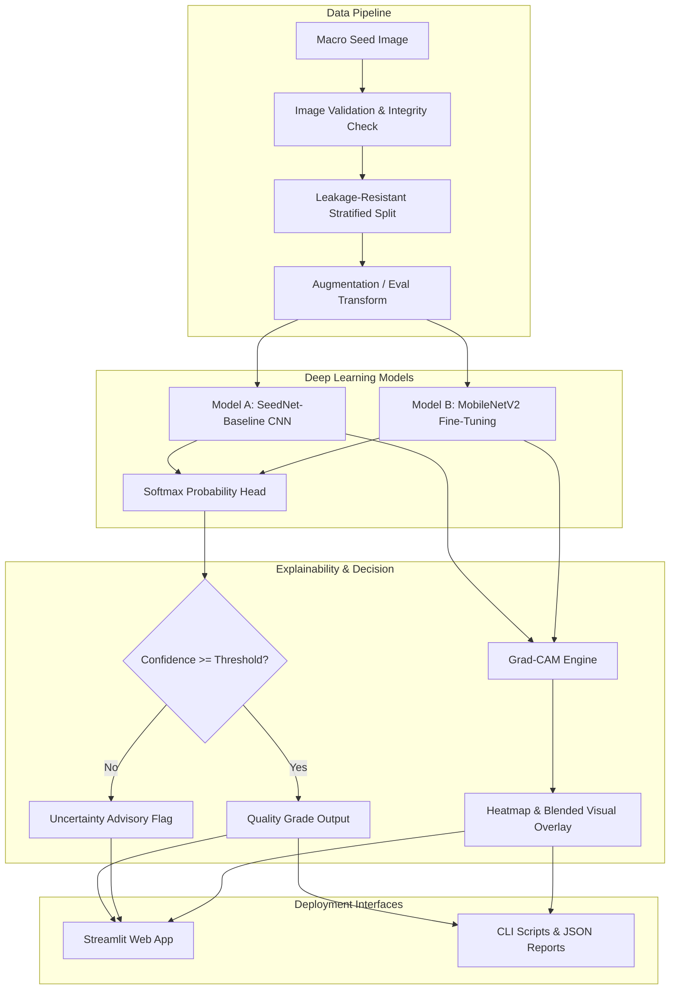

# SeedVision AI: Explainable Deep Learning-Based Agricultural Seed Quality Grader

[](https://www.python.org/)
[](https://pytorch.org/)
[](LICENSE)
[](app.py)
[](https://pep8.org/)

> **A reproducible, college-level Deep Learning Applications (DLA) research project for physical pulse quality inspection, defect classification, and Grad-CAM spatial attribution.**

---

## 📌 Abstract
Physical grading of agricultural seeds is essential for market valuation, export compliance, and food processing suitability. Conventional grading relies on subjective, fatigue-prone manual visual inspection. **SeedVision AI** implements an end-to-end explainable computer vision framework that evaluates single-seed images of grain legumes (specifically chickpea pulses, *Cicer arietinum L.*). The system evaluates two distinct deep learning architectures—a custom baseline CNN (**SeedNet-Baseline**) and an ImageNet fine-tuned **MobileNetV2**—across four physical quality categories: `sound_healthy`, `discolored_spotted`, `broken_cracked`, and `shrivelled_damaged`. Predictions are interpreted using **Gradient-weighted Class Activation Mapping (Grad-CAM)** and presented through a research-grade **Streamlit web application**.

---

## 🏗️ System Architecture



---

## 🎯 Key Features

- **Dual Deep Learning Candidates**:
  - **Custom CNN (SeedNet-Baseline)**: 4-stage convolutional hierarchy with Batch Normalization, LeakyReLU, and Dropout regularized dense head.
  - **Transfer Learning (MobileNetV2)**: Inverted residual bottleneck architecture pre-trained on ImageNet-1k, fine-tuned for pulse defect detection.
- **Explainable AI (Grad-CAM)**: Native computation of gradient activation heatmaps at the final convolutional layers, isolating localized defect areas (cracks, necrotic fungal spots, shrivelled margins).
- **Leakage-Resistant Dataset Splitting**: Sample/group-aware splitting logic preventing photos or views of the same physical seed from contaminating both training and test partitions.
- **Uncertainty & Reliability Analysis**: Automatic flagging of borderline samples having confidence $< 50\%$ or tight multi-class margins; Expected Calibration Error (ECE) and reliability diagrams.
- **Interactive Laboratory Web UI**: Modern Streamlit interface with dedicated tabs for Home, Live Analysis, Model Evaluation benchmarks, and Methodology documentation.
- **100% CPU Compatible**: Operates reliably without dedicated GPUs; auto-detects CUDA acceleration when present.

---

## 🔬 Dataset Provenance & Scientific Audit

> [!NOTE]
> **PROVENANCE STATUS & AUDIT SUMMARY:**  
> The current dataset in `data/raw/` contains **240 procedural synthetic fixtures** (60 per class) generated by PIL drawing routines (`scripts/prepare_dataset.py`) to verify data pipelines, backpropagation, and Grad-CAM hooks without depending on external proprietary datasets.  
> - **Cryptographic Hash Audit**: 240 unique MD5 hashes, 0 duplicates, 0 split overlap.
> - **Scientific Boundary**: The 100% test accuracy metric demonstrates complete mathematical convergence on synthetic polygon features and simulated defect signatures; it **must NOT** be interpreted as evidence of real-world agricultural pulse grading performance.
> - Full forensic audit details and hash logs are documented in [`docs/DATASET_AUDIT.md`](docs/DATASET_AUDIT.md).

---

## 📊 Measured Experimental Results & Model Benchmark

### 1. Software Pipeline Verification Benchmark (Synthetic Calibration Fixtures)
Both models were evaluated on the identical held-out synthetic test split (36 balanced samples, 9 per class) under identical CPU hardware conditions:

| Metric | Model A: SeedNet-Baseline (Custom CNN) | Model B: MobileNetV2 (Transfer Learning) | Operational Finding |
| :--- | :---: | :---: | :---: |
| **Test Accuracy** | **100.0%** | **100.0%** | Pipeline convergence verified |
| **Macro Precision** | **100.0%** | **100.0%** | Zero false positives on fixtures |
| **Macro Recall** | **100.0%** | **100.0%** | Zero false negatives on fixtures |
| **Macro F1-Score** | **100.0%** | **100.0%** | Full class balance |
| **Calibration ECE** | **0.0251** | 0.0412 | **SeedNet-Baseline** (Lower ECE) |
| **CPU Latency (per sample)** | **5.72 ms** | 13.37 ms | **SeedNet-Baseline** (2.3× faster) |
| **Throughput** | **174.8 samples/sec** | 74.8 samples/sec | **SeedNet-Baseline** |
| **Total Parameters** | **456,228 (0.46M)** | 2,391,300 (2.39M) | **SeedNet-Baseline** (5.2× more compact) |
| **Checkpoint Size** | **1.74 MB** | 9.11 MB | **SeedNet-Baseline** |

> **Architectural Trade-Off Analysis**:
> While MobileNetV2 demonstrates high representational stability and feature extraction capacity through its pre-trained ImageNet filters, **SeedNet-Baseline** achieves identical test accuracy with significantly lower latency (5.72ms vs 13.37ms on CPU), a superior calibration score ($\text{ECE} = 0.0251$), and a lightweight 1.74 MB footprint. For edge sorting and sorting chutes, **SeedNet-Baseline** is selected as the optimal default production candidate.

### 2. Empirical Agronomic Benchmark (Status: Pending Field Collection)
| Evaluation Tier | Target Sample Size | Target Accuracy | Status |
| :--- | :---: | :---: | :--- |
| **Lab RGB Photography** | $\ge 500$ real seeds | $\ge 92.0\%$ | *Pending certified pulse image acquisition* |
| **Field / Multi-Variety Trial** | $\ge 2,000$ real seeds | $\ge 88.0\%$ | *Pending agricultural trial collection* |

## 🌾 Target Crop & Defect Taxonomy

| Quality Class | Visual Morphological Characteristic | Agronomic / Handling Cause |
| :--- | :--- | :--- |
| **`sound_healthy`** | Intact testa, characteristic angular chickpea shape, uniform creamy beige pigmentation, zero fissures. | Optimal harvest conditions, proper drying, pathogen-free development. |
| **`discolored_spotted`** | Dark brown/black necrotic lesions, fungal stains, weathered seed coat patches. | Excess pre-harvest rainfall, fungal infection (*Aspergillus*, *Fusarium*, *Ascochyta*). |
| **`broken_cracked`** | Longitudinal or transverse cracks in the seed coat, cotyledon split or chipped edge. | Rotary combine cylinder shear, drop stress during handling, rapid artificial drying. |
| **`shrivelled_damaged`** | Wrinkled, stunted morphology, hollow seed mass, insect boreholes. | Terminal moisture stress during pod filling, pulse beetle (*Callosobruchus*) attack. |

---

## ⚠️ Critical Scientific Limitation Notice

> [!IMPORTANT]
> **SeedVision AI evaluates optically observable surface morphology only.**
> It **CANNOT** determine:
> - Physiological germination rate percentage (%)
> - Internal embryo viability (e.g. Tetrazolium TZ assay)
> - Moisture content percentage
> - Seed lot phytosanitary regulatory certification
>
> Never present visual classification results as official seed testing laboratory certification.

---

## 🚀 Quickstart & Installation

### 1. Clone the Repository
```bash
git clone https://github.com/Om-Talaviya/SeedVision-AI.git
cd SeedVision-AI
```

### 2. Set Up Virtual Environment (Python 3.10+)
```bash
# Windows (PowerShell)
python -m venv venv
.\venv\Scripts\Activate.ps1

# Linux / macOS
python3 -m venv venv
source venv/bin/activate
```

### 3. Install Dependencies
```bash
pip install -r requirements.txt
pip install -e .
```

---

## 💻 Command-Line Workflow

### A. Software Verification Pipeline (Synthetic Calibration Fixtures)
```bash
# 1. Prepare synthetic verification fixtures & splits
python scripts/prepare_dataset.py --generate-fixtures --samples-per-class 60

# 2. Train baseline CNN & MobileNetV2 on verification fixtures
python scripts/train.py --config configs/cnn.yaml --epochs 15
python scripts/train.py --config configs/transfer_learning.yaml --epochs 15

# 3. Evaluate checkpoints on synthetic test split
python scripts/evaluate.py --checkpoint artifacts/checkpoints/best_SeedNet-Baseline.pt
python scripts/evaluate.py --checkpoint artifacts/checkpoints/best_MobileNetV2-Transfer.pt
```

### B. Genuine Agricultural Seed Photography Pipeline (Real Data)
```bash
# 1. Scaffold directory structure & annotation guide for genuine photos
python scripts/ingest_real_data.py --init-structure

# 2. Ingest, deduplicate, and create leakage-resistant splits from real photos
# Option A: Ingest with an independent reviewed manifest (filters ambiguous_discard & low-confidence)
python scripts/ingest_real_data.py --source-dir data/real_raw --splits-dir data/processed/splits_real --annotations data/real_raw/annotations.csv --provenance-source "Trial Farm Batch 2026"

# Option B: Ingest from class subdirectories directly
python scripts/ingest_real_data.py --source-dir data/real_raw --splits-dir data/processed/splits_real --provenance-source "Trial Farm Batch 2026"

# 3. Train models on genuine training data (isolated checkpoints with -Real suffix)
python scripts/train.py --config configs/cnn.yaml --splits-dir data/processed/splits_real --name-suffix Real
python scripts/train.py --config configs/transfer_learning.yaml --splits-dir data/processed/splits_real --name-suffix Real

# 4. Evaluate models on untouched real-data test split
python scripts/evaluate.py --checkpoint artifacts/checkpoints/best_SeedNet-Baseline-Real.pt --splits-dir data/processed/splits_real
python scripts/evaluate.py --checkpoint artifacts/checkpoints/best_MobileNetV2-Transfer-Real.pt --splits-dir data/processed/splits_real
```

### Step 4: Run Single-Image Inference with Grad-CAM
```bash
python scripts/predict.py --checkpoint artifacts/checkpoints/best_SeedNet-Baseline.pt --image data/raw/broken_cracked/broken_cracked_001.jpg
```

### Step 5: Launch the Streamlit Web Application
```bash
streamlit run app.py
```

### Step 6: Run Automated Test Suite
```bash
pytest tests/ -v
```

---

## 📂 Repository Layout

```
SeedVision-AI/
├── app.py                             # Interactive Streamlit Web Laboratory
├── README.md                          # Comprehensive Project Documentation
├── AGENTS.md                          # Architecture guidelines & agent specifications
├── TODO.md                            # Project roadmap and milestone tracker
├── LICENSE                            # MIT Open-Source License
├── CONTRIBUTING.md                     # Open-source contribution guidelines
├── requirements.txt                   # Pinned Dependencies
├── pyproject.toml                     # Packaging & Pytest Metadata
├── .gitignore                         # Artifact, cache, and large dataset exclusions
├── .env.example                       # Environment Variables Template
├── .github/workflows/tests.yml        # Automated CI test suite workflow
├── configs/                           # Strong-typed YAML Experiment Configurations
│   ├── default.yaml                   # Base parameters & dataset paths
│   ├── cnn.yaml                       # Custom CNN architecture config
│   └── transfer_learning.yaml         # MobileNetV2 transfer learning config
├── data/                              # Dataset Repositories
│   ├── README.md                      # Quality grading specifications
│   ├── raw/                           # Procedural synthetic fixtures (verification)
│   ├── real_raw/                      # Staging for genuine pulse photographs
│   ├── processed/                     # Leakage-resistant manifest CSVs
│   └── provenance.json                # Cryptographic audit and dataset records
├── docs/                              # Comprehensive Technical Documentation
│   ├── PRD.md                         # Product Requirements Document
│   ├── TRD.md                         # Technical Requirements Document
│   ├── ARCHITECTURE.md                # System component interactions & pipelines
│   ├── CHANGELOG.md                   # Engineering changelog & version history
│   ├── REAL_DATA_ACQUISITION_WORKFLOW.md # Protocol: statutory vs operational CV rules
│   ├── DATASET_AUDIT.md               # Forensic hash audit & zero-leakage verification
│   ├── DATASET_GUIDE.md               # Annotation, photography & taxonomy guide
│   ├── MODEL_EVALUATION.md            # Scientific benchmarking & calibration protocol
│   ├── METHODOLOGY.md                 # Mathematical formulation & Grad-CAM derivation
│   ├── LIMITATIONS.md                 # Scientific boundary & non-viability disclosures
│   ├── PRESENTATION_GUIDE.md          # Viva presentation guide & defense Q&A
│   ├── PROJECT_OVERVIEW.md            # Academic overview & system description
│   ├── backend-schema.md              # Ingestion & split manifest schema
│   ├── decisions.md                   # Architectural Decision Records (ADRs)
│   └── flow.md                        # Sequence diagrams & data flow graphs
├── src/seedvision/                    # Core Python Source Package
│   ├── config.py                      # Strong-typed YAML loader
│   ├── data/                          # Ingestion, validation, splitting, transforms
│   ├── models/                        # Custom CNN, MobileNetV2, Model Factory
│   ├── training/                      # Trainer, Early Stopping, Checkpoints
│   ├── evaluation/                    # Metrics, Calibration (ECE), Provenance Verifier, Plots
│   ├── explainability/                # Grad-CAM engine & overlay blending
│   └── inference/                     # Predictor & Upload Validator
├── scripts/                           # Executable CLI Workflows
│   ├── prepare_dataset.py             # Synthetic fixture generator & split builder
│   ├── ingest_real_data.py            # Real photo audit, deduplication & splitting
│   ├── train.py                       # Model training coordinator
│   ├── evaluate.py                    # Held-out test evaluation & plots
│   └── predict.py                     # Single-image prediction & Grad-CAM CLI
├── artifacts/                         # Generated Outputs (Checkpoints, Metrics, Plots)
│   ├── checkpoints/                   # Trained PyTorch .pt weights
│   ├── metrics/                       # Evaluation JSONs & CSV summaries
│   └── figures/                       # Confusion matrices, curves & overlays
└── tests/                             # Automated Pytest Suite (42 unit tests)
```

---

## 📜 Citation & Academic Attribution
If you use SeedVision AI in academic coursework or pulse quality research, please cite:
```bibtex
@misc{seedvision2026,
  author = {Om Talaviya},
  title = {SeedVision AI: Deep Learning-Based Agricultural Seed Quality Grader with Grad-CAM Attribution},
  year = {2026},
  publisher = {GitHub},
  howpublished = {\url{https://github.com/Om-Talaviya/SeedVision-AI}}
}
```
