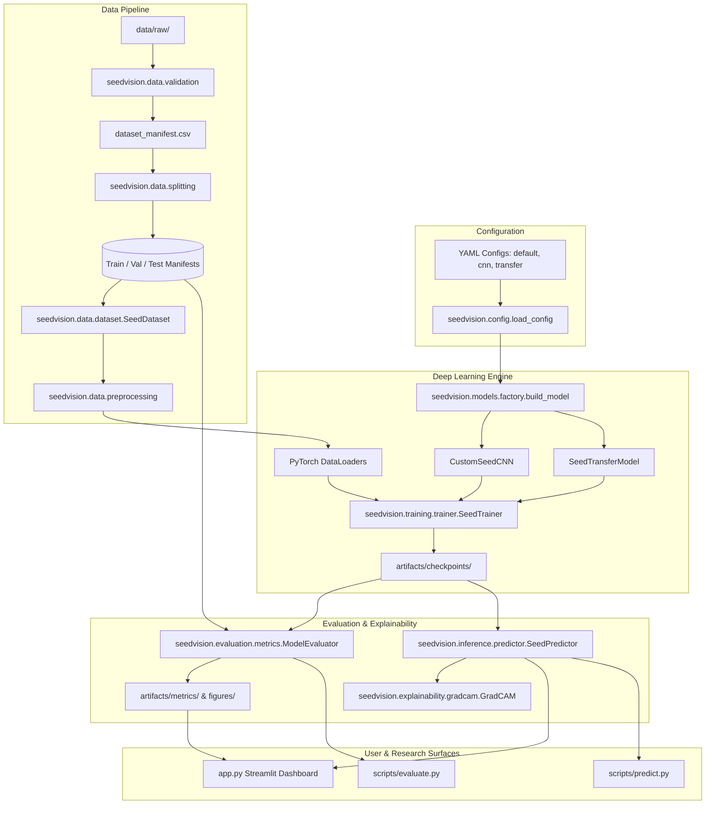

# SeedVision AI: System Architecture & Subsystem Specification

## 1. Architectural Blueprint

SeedVision AI adopts a modular, decoupled Python architecture centered around strong contracts, reproducible configuration cascades, and transparent deep learning workflows.

---

## 2. Subsystem Decomposition

### 2.1 Configuration Subsystem (`seedvision.config`)
- **Pattern**: Layered Data Classes with recursive dictionary merging.
- **Contract**: Base defaults (`configs/default.yaml`) are layered with architecture-specific overrides (`configs/cnn.yaml` or `configs/transfer_learning.yaml`).
- **Device Resolution**: Auto-detects CUDA hardware; falls back seamlessly to CPU.

### 2.2 Data Pipeline Subsystem (`seedvision.data`)
- **`validation.py`**: Validates file integrity, dimensions ($W, H \ge 16$), and computes SHA-256 content hashes to detect and eliminate duplicate images across classes.
- **`preprocessing.py`**: Manages train-time augmentation (modest rotations, flips, subtle color jitter) and deterministic eval-time normalization.
- **`splitting.py`**: Implements **class-stratified group splitting**. For each class, physical seed entities (`seed_id`) are partitioned as atomic groups, preventing inter-split leakage while preserving class balance.
- **`dataset.py`**: PyTorch `Dataset` providing lazy PIL image decoding, RGB verification, and DataLoader instantiation.

### 2.3 Modeling Subsystem (`seedvision.models`)
- **`cnn.py`**: Custom 4-stage convolutional neural network (`CustomSeedCNN`) using Kaiming weight initialization, batch normalization, and LeakyReLU activations.
- **`transfer_learning.py`**: Inverted residual MobileNetV2 architecture with selective backbone freeze/unfreeze and custom classification head.
- **`factory.py`**: Abstract builder resolving model instances from string identifiers and calculating parameter/memory footprints.

### 2.4 Training Subsystem (`seedvision.training`)
- **`trainer.py`**: Manages the training and validation loops, Cross-Entropy loss with label smoothing ($\epsilon=0.05$), Cosine Annealing learning rate schedule, gradient norm clipping ($\le 1.0$), and early stopping.
- **`checkpoints.py`**: Atomic persistence of `.pt` weights and human-readable `.pt.meta.json` companion metadata files.
- **`history.py`**: Epoch-by-epoch loss, accuracy, and learning rate telemetry exported to JSON and CSV.

### 2.5 Evaluation Subsystem (`seedvision.evaluation`)
- **`metrics.py`**: Calculates Accuracy, Macro Precision, Macro Recall, Macro F1, per-class metrics, confusion matrices, and Expected Calibration Error (ECE).
- **`plots.py`**: High-resolution Matplotlib figures (dual-axis convergence curves, confusion matrix heatmaps, reliability diagrams, and per-class bars).
- **`compare.py`**: Ingests multiple model evaluation JSONs to build a unified comparative benchmark table and summary chart.

### 2.6 Explainability Subsystem (`seedvision.explainability`)
- **`gradcam.py`**: Encapsulates forward/backward hook registration, activation map extraction, gradient pooling, ReLU rectification, min-max normalization, and OpenCV color overlay blending.
- **Resource Discipline**: Utilizes context manager protocol (`__enter__` / `__exit__`) to guarantee all PyTorch hooks are removed.

### 2.7 Inference Subsystem (`seedvision.inference`)
- **`predictor.py`**: Production inference wrapper that loads checkpoints, runs forward passes, derives Top-K predictions, applies uncertainty heuristics, and coordinates Grad-CAM overlays.
- **`validation.py`**: Sanitizes user uploads (file size, MIME type, dimensions) before feeding tensors to models.

---

## 3. Cross-Cutting Engineering Standards
1. **Memory & Cache Management**: The Streamlit application leverages `@st.cache_resource` on model loaders to eliminate weight re-parsing across user queries.
2. **Deterministic Reproducibility**: Master seed (`seed = 42`) set across `random`, `numpy`, and `torch` runtimes.
3. **Structured Logging**: Standard Python `logging` used across all modules with descriptive timestamps and metric outputs.
