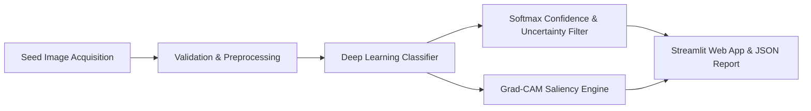

# SeedVision AI: Deep Learning-Based Agricultural Seed Quality Grader

## Executive Summary
**SeedVision AI** is an explainable computer vision system engineered to grade the visually observable physical quality of agricultural seeds (specifically chickpea pulses, *Cicer arietinum L.*). The system integrates dual deep learning architectures—a customized Convolutional Neural Network baseline (**SeedNet-Baseline**) and a transfer-learning candidate (**MobileNetV2**)—to classify seeds into four standardized physical grading categories:
1. `sound_healthy`
2. `discolored_spotted`
3. `broken_cracked`
4. `shrivelled_damaged`

Furthermore, SeedVision AI incorporates **Gradient-weighted Class Activation Mapping (Grad-CAM)** to visually highlight the local morphological regions (fracture lines, fungal lesions, or surface shrivelling) that govern the network's predictive decision.

## Problem Statement
In grain legume and pulse supply chains, physical quality assessment directly dictates market valuation, processing efficiency, and seed lot trade viability. Conventional grading relies almost exclusively on manual visual inspection by human inspectors, which suffers from:
- Subjectivity and inter-annotator disagreement.
- Operator eye fatigue during high-throughput procurement.
- Lack of auditability or recorded visual evidence.

## Proposed Solution
SeedVision AI provides a standardized, objective, reproducible deep learning pipeline with:
- **Leakage-Resistant Splits**: Grouped train/val/test splits preserving seed identity.
- **Dual Architecture Comparison**: Rigorous empirical benchmarking between a custom lightweight CNN and a transfer learning backbone.
- **Explainable AI (XAI)**: Native Grad-CAM attribution showing why a seed received a defect classification.
- **Uncertainty Flagging**: Automated identification of ambiguous samples with confidence below scientific thresholds.
- **Interactive Laboratory UI**: A modern Streamlit web application for real-time inference and research evaluation.
