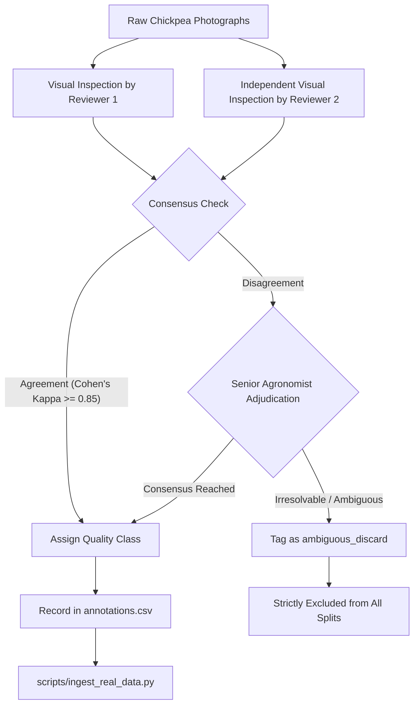

# SeedVision AI: Real-World Dataset Acquisition & Human Annotation Protocol

**Document Version:** 1.1.0  
**Status:** Approved Operational Protocol  
**Target Crop:** Chickpea (*Cicer arietinum L.*), Desi and Kabuli cultivars  
**Target Defect Taxonomy:** `sound_healthy`, `discolored_spotted`, `broken_cracked`, `shrivelled_damaged`  

---

## 1. Statutory Standards vs. Project-Defined Operational Proxies

In accordance with rigorous academic and scientific standards, SeedVision AI strictly distinguishes **statutory commercial grain standards** from **project-defined operational computer-vision proxies**:

### 1.1 Verified Official Standards (AGMARK & USDA GIPSA)
Official commercial grain grading standards evaluate pulses at the **bulk lot level** using representative physical sampling and **mass percentage tolerances (by weight)**:
1. **AGMARK India (Agricultural Produce Grading and Marking Act, 1937 — Pulses Grading and Marking Rules, 2004)**:
   - For Bengal Gram / Chickpea (*Cicer arietinum L.*), quality grade classifications (Grade I, II, III) specify maximum limits of tolerance:
     - **Damaged / Slightly Damaged grains**: Max 1.0% to 3.0% by weight.
     - **Broken grains**: Pieces of cotyledon less than 3/4 of whole seed, max 1.0% to 3.0% by weight.
     - **Shrivelled / Immature grains**: Underdeveloped or wrinkled seeds, max 1.0% to 4.0% by weight.
     - **Weevilled grains**: Grains bored by pulse beetle (*Callosobruchus*), max 0.5% to 2.0% by count/weight.
2. **USDA GIPSA / FGIS (United States Standards for Chickpeas / Garbanzo Beans, 2011/2014)**:
   - Defines grades U.S. No. 1, U.S. No. 2, U.S. No. 3, and Substandard based on:
     - **Damaged chickpeas (total)**: Max 2.0% (No. 1) to 4.0% (No. 2) by weight.
     - **Broken chickpeas**: Grains with half or more missing, max 0.5% (No. 1) to 1.0% (No. 2) by weight.
     - **Distinctly discolored chickpeas**: Beans altered by weather or disease, max 2.0% (No. 1).

### 1.2 Project-Defined Single-Seed Operational Proxies
> [!IMPORTANT]
> **STATUTORY BOUNDARY CLARIFICATION:**
> Official grain standards (AGMARK & USDA GIPSA) **do NOT define microscopic pixel thresholds** (such as "crack length $>1.5\text{ mm}$" or "spot surface coverage $\ge 5\%$") for individual isolated seeds.
> 
> The metric cutoffs in SeedVision AI are **project-defined operational proxies** developed specifically for single-seed RGB macro-photographs. They are qualitatively grounded in commercial defect categories, but the numerical millimeter and percentage thresholds are technical specifications of this project, NOT statutory regulations.

| Quality Class | Qualitative Defect Category | Project-Defined Operational CV Threshold | Official Standard Analogue |
| :--- | :--- | :--- | :--- |
| `sound_healthy` | Unblemished, intact whole pulse | Outer testa intact; zero cracks; dark spots $\le 1.0\text{ mm}$ | Sound, wholesome grain |
| `discolored_spotted` | Weather, mold, or fungal blemish | Necrotic stains or fungal spots covering $\ge 5\%$ of observable surface | "Slightly Damaged / Discolored" (AGMARK/USDA) |
| `broken_cracked` | Mechanical damage, cotyledon fissure | Mechanical crack $> 1.5\text{ mm}$ in length exposing underlying cotyledon | "Broken Grains" (cotyledon cleavage) |
| `shrivelled_damaged` | Insect bored, terminal drought shrivel | Projected seed volume/area $< 75\%$ healthy norm, or any visible circular borehole | "Shrivelled / Weevilled Grains" |

---

## 2. Public Pulse Dataset Audit: PulseLibrary

As established during our forensic audit, the most suitable open-access photographic pulse repository is **PulseLibrary**:

- **Repository:** Mendeley Data
- **Dataset Title:** *PulseLibrary: A Dataset of Diverse Images Across Six Commercially Important Pulse Species*
- **Persistent Identifier (DOI):** [`10.17632/kw7x5xyprh.1`](https://doi.org/10.17632/kw7x5xyprh.1)
- **Publication Date:** September 15, 2026
- **Authors:** Afsana Turabin Indana, Shuhurat Fariha, Maisha Sameha, Noor Mairukh Khan Arnob, Md Mubtasim Fuad
- **Affiliations:** University of Asia Pacific (Bangladesh) & Florida International University (USA)
- **License:** Creative Commons Attribution 4.0 International (**CC BY 4.0**)
- **Dataset Contents:** 3,123 high-resolution photographs covering six pulse species: *Chickpea (Cicer arietinum)*, *Grass pea*, *Red lentil*, *Black gram*, *Mung bean*, and *Peas*.

### 2.1 Download and Extraction Instructions
1. Navigate to the Mendeley Data repository: `https://data.mendeley.com/datasets/kw7x5xyprh/1`.
2. Download the compressed archive `PulseLibrary.zip`.
3. Extract the archive and isolate the `chickpea/` folder.
4. **DO NOT train directly on the uncurated folder.** The raw PulseLibrary dataset categorizes images by **botanical species**, not physical quality defects. Inferring quality grades from species tags is strictly forbidden. Unreviewed images must remain in staging.

---

## 3. Human-in-the-Loop Annotation Protocol

Because raw public chickpea images lack quality defect annotations, researchers must run human review using the following standardized protocol:



### 3.1 Severity Precedence Hierarchy
When physical agricultural seeds exhibit multiple co-occurring defects (e.g. a seed is both cracked and discolored), inspectors apply the severity hierarchy:

$$\text{shrivelled\_damaged (Priority 1)} \succ \text{broken\_cracked (Priority 2)} \succ \text{discolored\_spotted (Priority 3)} \succ \text{sound\_healthy (Baseline)}$$

- **Example 1:** A seed with a small fungal spot that also has an insect borehole is classified as **`shrivelled_damaged`**.
- **Example 2:** A seed with a split cotyledon that also exhibits pre-harvest moisture staining is classified as **`broken_cracked`**.

### 3.2 Independent Dual-Review & Disagreement Resolution
1. **Independent Review**: Reviewer 1 and Reviewer 2 inspect each seed photograph independently without sharing marks.
2. **Inter-Annotator Reliability**: Cohen's Kappa $\kappa$ is computed on a shared calibration batch of at least 100 seeds:
   $$\kappa = \frac{p_o - p_e}{1 - p_e}$$
   Target threshold: $\kappa \ge 0.85$. If $\kappa < 0.80$, reviewing guidelines are re-calibrated.
3. **Disagreement Resolution**: Any discrepancy is submitted to a **Senior Agronomist / Grain Inspector**. The senior adjudicator examines the high-resolution macro-photograph to determine the primary defect.
4. **Ambiguous Label Policy (`ambiguous_discard`)**: If a seed cannot be confidently categorized due to lighting glare, poor focus, foreign dust, or indeterminate symptoms, it is flagged as `ambiguous_discard`. **All `ambiguous_discard` samples are strictly excluded from the training, validation, and test splits.**

---

## 4. Metadata Recording Schema (`annotations.csv`)

Every human-reviewed image must be logged in `data/real_raw/annotations.csv` using the schema:

| Column | Type | Required | Description | Example |
| :--- | :--- | :--- | :--- | :--- |
| `filename` | String | Yes | Base image filename on disk | `chickpea_B1_S042_v1.jpg` |
| `class_name` | String | Yes | Valid quality label or `ambiguous_discard` | `broken_cracked` |
| `seed_id` | String | Yes | Unique physical seed identifier | `seed_042` |
| `batch_id` | String | No | Seed lot / harvest session identifier | `lot_2026_fieldA` |
| `variety` | String | No | Botanical cultivar (Desi / Kabuli / named variety) | `Desi (JG-11)` |
| `primary_defect`| String | No | Specific morphological defect note | `transverse cotyledon crack` |
| `secondary_defect`| String| No | Optional co-occurring secondary defect | `surface moisture staining` |
| `annotator_id` | String | Yes | Unique reviewer identifier | `inspector_01` |
| `annotation_date` | String | Yes | ISO 8601 date | `2026-10-15` |
| `confidence` | String | Yes | Reviewer certainty (`high`, `medium`, `low`) | `high` |

---

## 5. Three-Stage Scientific Validation Roadmap

To prevent premature accuracy claims, the project strictly adheres to three distinct scientific stages:

```
[ Stage 1: Synthetic Pipeline Verification ]
  └─ Status: COMPLETED & VERIFIED (36/36 tests passing)
  └─ Purpose: Validate PyTorch tensor pipelines, Grad-CAM hooks, ECE, and Streamlit UI.
  └─ Artifacts: Checkpoints tagged best_SeedNet-Baseline.pt (marked Synthetic).

[ Stage 2: Genuine Real-World Training ]
  └─ Status: READY FOR EXECUTION (Awaiting reviewed chickpea dataset)
  └─ Purpose: Train custom CNN and MobileNetV2 on verified human-annotated photos.
  └─ Ingestion: scripts/ingest_real_data.py enforces group-isolated zero-leakage splits.
  └─ Artifacts: Checkpoints tagged best_SeedNet-Baseline-Real.pt (strictly isolated).

[ Stage 3: Untouched Real-World Test Benchmark ]
  └─ Status: PENDING COMPLETION OF STAGE 2
  └─ Purpose: Evaluate model checkpoints on untouched held-out test manifest.
  └─ Artifacts: Metrics saved in artifacts/metrics/eval_*-Real.json (tagged Real-World).
  └─ Rule: NO real-world accuracy numbers may be published until Stage 3 is executed.
```

---

## 6. Scientific & Regulatory Boundaries

> [!CAUTION]
> **SURFACE OPTICAL BOUNDARY NOTICE:**
> RGB visual classification evaluates **external physical morphology only**.
> 
> Under no circumstances may an optical prediction be cited as evidence of:
> - **Germination Capacity:** Requires ISTA paper-roll / sand germination test (7–10 days).
> - **Internal Embryo Viability:** Requires biochemical 2,3,5-triphenyl tetrazolium chloride (TZ) enzymatic staining.
> - **Moisture Content:** Requires standard air-oven drying at $130^\circ\text{C}$ or calibrated capacitive moisture meters.
> - **Phytosanitary Certification:** Requires laboratory fungal plating or ELISA/PCR pathogen testing.
