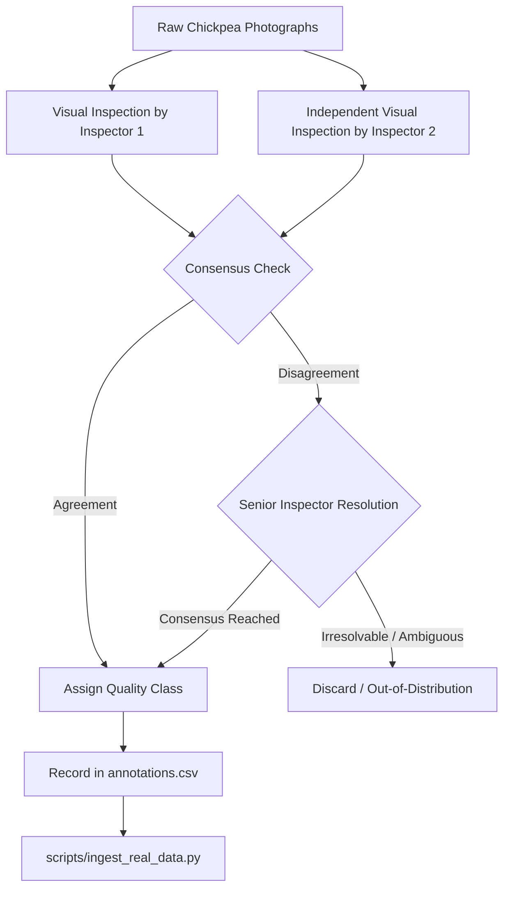

# SeedVision AI: Real-World Dataset Acquisition & Human Annotation Protocol

**Document Version:** 1.0.0  
**Status:** Approved Operational Protocol  
**Target Crop:** Chickpea (*Cicer arietinum L.*), Desi and Kabuli cultivars  
**Target Defect Taxonomy:** `sound_healthy`, `discolored_spotted`, `broken_cracked`, `shrivelled_damaged`  

---

## 1. Public Pulse Dataset Audit: PulseLibrary

As established during our forensic audit, the most suitable open-access photographic pulse repository is **PulseLibrary**:

- **Repository:** Mendeley Data
- **Dataset Title:** *PulseLibrary: A Dataset of Diverse Images Across Six Commercially Important Pulse Species*
- **Persistent Identifier (DOI):** [`10.17632/kw7x5xyprh.1`](https://doi.org/10.17632/kw7x5xyprh.1)
- **Publication Date:** September 15, 2026
- **Authors:** Afsana Turabin Indana, Shuhurat Fariha, Maisha Sameha, Noor Mairukh Khan Arnob, Md Mubtasim Fuad
- **Affiliations:** University of Asia Pacific (Bangladesh) & Florida International University (USA)
- **License:** Creative Commons Attribution 4.0 International (**CC BY 4.0**)
- **Dataset Contents:** 3,123 high-resolution photographs covering six pulse species: *Chickpea (Cicer arietinum)*, *Grass pea*, *Red lentil*, *Black gram*, *Mung bean*, and *Peas*.

### 1.1 Download and Extraction Instructions
1. Navigate to the Mendeley Data repository: `https://data.mendeley.com/datasets/kw7x5xyprh/1`.
2. Download the compressed archive `PulseLibrary.zip`.
3. Extract the archive and isolate the `chickpea/` folder.
4. **DO NOT train directly on the uncurated folder.** The raw PulseLibrary dataset categorizes images by **botanical species**, not physical quality defects. Inferring quality grades from species tags is strictly forbidden.

---

## 2. Human-in-the-Loop Annotation Protocol

Because raw public chickpea images lack quality defect annotations, researchers must run human review using the following standardized protocol:

### 2.1 Operational Class Definitions

#### 1. `sound_healthy`
- **Visual Morphology:** Intact outer testa (seed coat), smooth-to-slightly-rugose texture, characteristic angular chickpea beak/keel.
- **Coloration:** Uniform natural pigmentation (creamy beige for Kabuli, yellowish-brown to dark brown for Desi varieties).
- **Tolerance:** No mechanical fractures, cotyledon exposure, or dark spots exceeding $1.0\text{ mm}$ in diameter.

#### 2. `discolored_spotted`
- **Visual Morphology:** Visible necrotic staining, brown/black fungal lesions, or dark mottled weathering across the testa.
- **Etiology:** Field rainfall during maturity, *Ascochyta rabiei* blight, or *Fusarium* surface colonization.
- **Threshold:** Discoloration or spots covering $\ge 5\%$ of the observable seed surface.

#### 3. `broken_cracked`
- **Visual Morphology:** Clear longitudinal, transverse, or radial fissures in the seed coat; cotyledon cleavage; missing seed coat fragments.
- **Etiology:** Mechanical impact from threshing cylinders, combine harvester augers, or thermal shock during artificial drying.
- **Threshold:** Visible crack $> 1.5\text{ mm}$ in length exposing the underlying cotyledon.

#### 4. `shrivelled_damaged`
- **Visual Morphology:** Severe shrinkage, hollowed seed mass, wrinkled non-convex perimeter, stunted cotyledons, or insect boreholes.
- **Etiology:** Terminal drought stress during pod filling, frost injury, or pulse beetle (*Callosobruchus maculatus*) oviposition and emergence.
- **Threshold:** Seed volume/mass visibly $< 75\%$ of healthy variety standard, or any circular borehole visible.

---

## 3. Resolving Ambiguities & Multi-Defect Hierarchy

When physical agricultural seeds exhibit multiple co-occurring defects (e.g. a seed is both cracked and discolored):

### 3.1 Severity Precedence Hierarchy
Grain marketing standards (USDA GIPSA and AGMARK India) penalize severe physical and structural loss over cosmetic staining:

$$\text{shrivelled\_damaged (Priority 1)} \succ \text{broken\_cracked (Priority 2)} \succ \text{discolored\_spotted (Priority 3)} \succ \text{sound\_healthy (Baseline)}$$

- **Example 1:** A seed with a small fungal spot that also has an insect borehole is classified as **`shrivelled_damaged`**.
- **Example 2:** A seed with a split cotyledon that also exhibits pre-harvest moisture staining is classified as **`broken_cracked`**.

### 3.2 Handling Ambiguous / Low-Confidence Seeds
If a sample cannot be confidently categorized by inspectors due to poor focus, foreign debris, or ambiguous symptoms:
- **Rule:** Flag as `ambiguous_discard`.
- **Action:** Exclude from the training and test sets. Do not force an arbitrary label.

### 3.3 Inter-Annotator Agreement (Cohen's Kappa)
- Two qualified inspectors must independently grade a validation batch of at least 100 seeds.
- Compute Cohen's Kappa $\kappa$:
  $$\kappa = \frac{p_o - p_e}{1 - p_e}$$
- Target Agreement: $\kappa \ge 0.85$ (Strong Agreement). If $\kappa < 0.80$, review discrepancies and re-calibrate inspectors before dataset finalization.

---

## 4. Metadata Recording Schema

Every human-reviewed image must be logged in `data/real_raw/annotations.csv` using the schema:

| Column | Type | Description | Example |
| :--- | :--- | :--- | :--- |
| `filename` | String | Base image filename on disk | `chickpea_B1_S042_v1.jpg` |
| `class_name` | String | Valid quality label from the 4 project classes | `broken_cracked` |
| `seed_id` | String | Unique physical seed identifier | `seed_042` |
| `batch_id` | String | Seed lot / harvest session identifier | `lot_2026_fieldA` |
| `variety` | String | Botanical cultivar (Desi / Kabuli / named variety) | `Desi (JG-11)` |
| `primary_defect`| String | Specific defect note | `transverse cotyledon crack` |
| `secondary_defect`| String | Optional co-occurring secondary defect | `surface moisture staining` |
| `annotator_id` | String | Unique reviewer identifier | `inspector_01` |
| `annotation_date` | String | ISO 8601 date | `2026-10-15` |
| `confidence` | String | Reviewer certainty (`high`, `medium`, `low`) | `high` |

---

## 5. Scientific & Regulatory Boundaries

> [!CAUTION]
> **SURFACE OPTICAL BOUNDARY NOTICE:**
> RGB visual classification evaluates **external physical morphology only**.
> 
> Under no circumstances may an optical prediction be cited as evidence of:
> - **Germination Capacity:** Requires ISTA paper-roll / sand germination test (7–10 days).
> - **Internal Embryo Viability:** Requires biochemical 2,3,5-triphenyl tetrazolium chloride (TZ) enzymatic staining.
> - **Moisture Content:** Requires standard air-oven drying at $130^\circ\text{C}$ or calibrated capacitive moisture meters.
> - **Phytosanitary Certification:** Requires laboratory fungal plating or ELISA/PCR pathogen testing.
