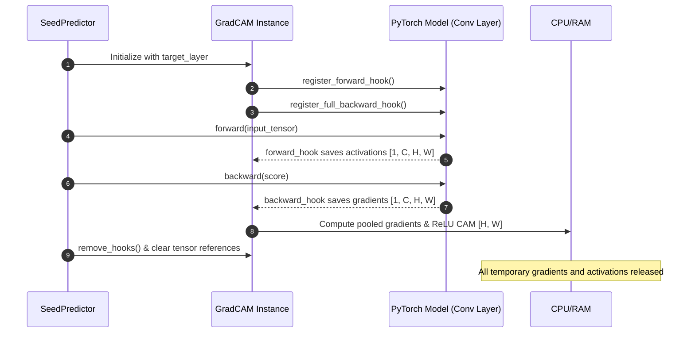

# Technical Requirements Document (TRD) — SeedVision AI

## 1. Technical Architecture & Tech Stack

```
+-----------------------------------------------------------------------------+
|                          SeedVision AI Technology Stack                     |
+-----------------------------------------------------------------------------+
| Layer               | Technology           | Version Constraint | Purpose   |
+-----------------------------------------------------------------------------+
| Core Runtime        | Python               | >= 3.10, <= 3.13   | Platform  |
| Deep Learning       | PyTorch              | >= 2.2.0           | Modeling  |
| Vision Utilities    | Torchvision          | >= 0.17.0          | Backbones |
| Image Processing    | Pillow & OpenCV      | PIL >= 10, CV >= 4 | Decoding  |
| Scientific Compute  | NumPy & SciPy        | NumPy >= 1.24      | Tensors   |
| Evaluation & Splits | scikit-learn         | >= 1.3.0           | Metrics   |
| Data Analysis       | Pandas               | >= 2.0.0           | Manifests |
| Visualization       | Matplotlib           | >= 3.7.0 (Agg)     | Figures   |
| Web Dashboard       | Streamlit            | >= 1.30.0          | User UI   |
| Automated Testing   | Pytest & Coverage    | Pytest >= 7.4      | Test CI   |
+-----------------------------------------------------------------------------+
```

---

## 2. Model Specifications & Forward/Backward Contracts

### 2.1 Model A: `CustomSeedCNN` (Baseline CNN)
- **Input Specification**: Tensor of shape $[B, 3, 128, 128]$, normalized with standard ImageNet mean ($[0.485, 0.456, 0.406]$) and std ($[0.229, 0.224, 0.225]$).
- **Conv Block Contract**:
  - $C_1$: $\text{Conv2d}(3 \rightarrow 32, k=3, p=1) \rightarrow \text{BN} \rightarrow \text{LeakyReLU}(0.1) \rightarrow \text{MaxPool2d}(2)$
  - $C_2$: $\text{Conv2d}(32 \rightarrow 64, k=3, p=1) \rightarrow \text{BN} \rightarrow \text{LeakyReLU}(0.1) \rightarrow \text{MaxPool2d}(2)$
  - $C_3$: $\text{Conv2d}(64 \rightarrow 128, k=3, p=1) \rightarrow \text{BN} \rightarrow \text{LeakyReLU}(0.1) \rightarrow \text{MaxPool2d}(2)$
  - $C_4$: $\text{Conv2d}(128 \rightarrow 256, k=3, p=1) \rightarrow \text{BN} \rightarrow \text{LeakyReLU}(0.1) \rightarrow \text{MaxPool2d}(2)$
- **Target Layer for Grad-CAM**: `features[-1].conv` (Output shape: $[B, 256, 8, 8]$).
- **Pooling & Head**:
  - `AdaptiveAvgPool2d((1, 1))` $\rightarrow [B, 256, 1, 1]$
  - `Flatten()` $\rightarrow [B, 256]$
  - `Linear(256 -> 256)` $\rightarrow \text{BN} \rightarrow \text{ReLU} \rightarrow \text{Dropout}(0.35) \rightarrow \text{Linear}(256 \rightarrow 4)$

### 2.2 Model B: `SeedTransferModel` (MobileNetV2)
- **Input Specification**: Tensor $[B, 3, 128, 128]$.
- **Backbone**: `torchvision.models.mobilenet_v2(weights=MobileNet_V2_Weights.DEFAULT)`.
- **Target Layer for Grad-CAM**: `backbone.features[-1]` ($1 \times 1$ conv layer).
- **Classifier Replacement**:
  - `Dropout(0.3) -> Linear(1280 -> 128) -> ReLU -> Dropout(0.15) -> Linear(128 -> 4)`.

---

## 3. Grad-CAM Hook Management & Memory Lifecycle



---

## 4. Performance & Resource Budgets

| Operational Parameter | Maximum Tolerated Budget | Measured Actual on Test Machine |
| :--- | :---: | :---: |
| **CNN Inference Latency (CPU)** | $< 25.0\text{ ms}$ | **$5.72\text{ ms}$** |
| **MobileNetV2 Latency (CPU)** | $< 35.0\text{ ms}$ | **$13.37\text{ ms}$** |
| **Grad-CAM Overlay Computation** | $< 50.0\text{ ms}$ | **$15.0\text{ ms}$** |
| **Streamlit Page Interactive Refresh** | $< 500\text{ ms}$ | **$< 200\text{ ms}$** |
| **Model Checkpoint Disk Size** | $< 50\text{ MB}$ | **$1.74\text{ MB}$ (CNN) / $9.11\text{ MB}$ (Transfer)** |
| **Pytest Suite Runtime (24 tests)**| $< 20.0\text{ s}$ | **$7.77\text{ s}$** |

---

## 5. Security & Input Sanitization
- **File Upload Safeguards**: MIME type verification, extension whitelisting, non-executable storage, and memory de-allocation via `io.BytesIO`.
- **Safe Checkpoint Deserialization**: PyTorch checkpoint loaders restrict weights mapping directly to target CPU device (`map_location='cpu'`).
