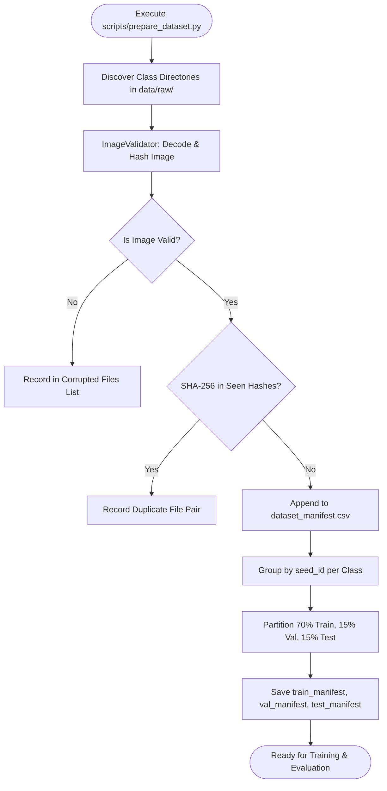
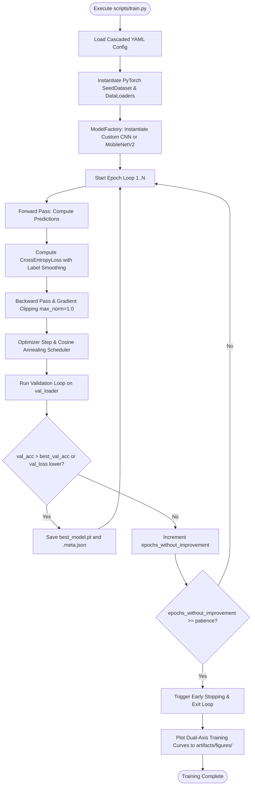
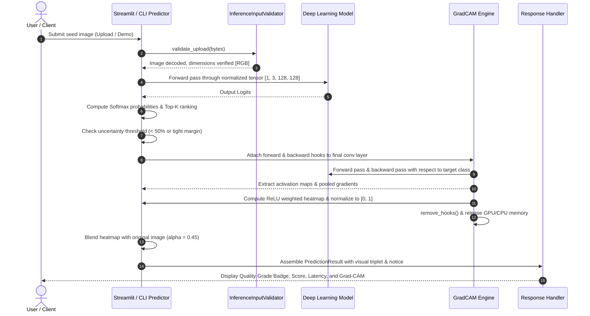
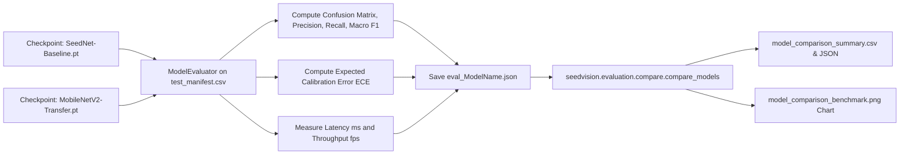

# SeedVision AI: Execution Flows & Sequence Workflows

This document illustrates the operational execution flows of SeedVision AI across data ingestion, model training, evaluation, real-time inference, and user web interactions.

---

## 1. Dataset Preparation & Leakage-Resistant Splitting Flow

---

## 2. Model Training & Checkpoint Lifecycle Flow

---

## 3. Real-Time Inference & Grad-CAM Saliency Flow

---

## 4. Multi-Model Evaluation & Cross-Benchmark Flow

